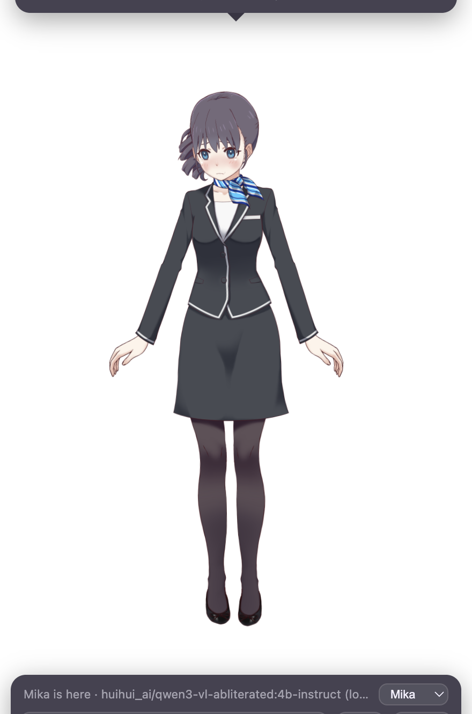
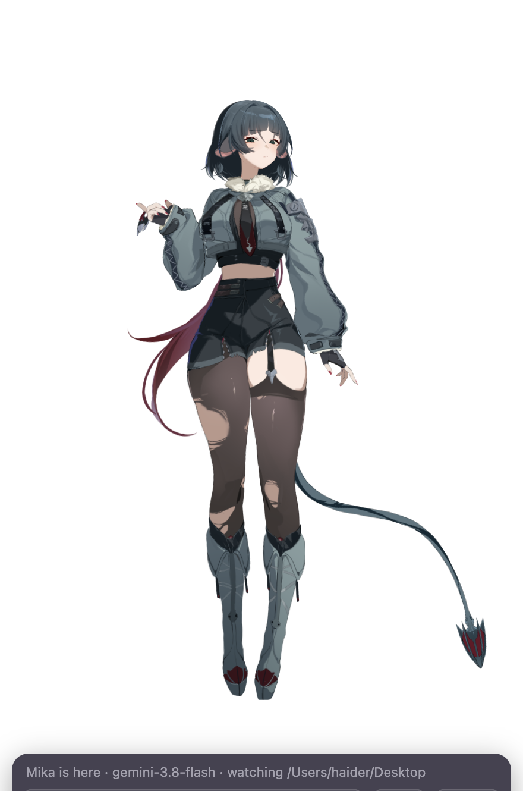

<p align="center">
  
</p>

<h1 align="center">Deskmate</h1>

<p align="center">
  <b>A Live2D AI companion that lives on your desktop.</b><br>
  She watches what you're doing, talks back with a real voice and real expressions, remembers you, and reacts when you poke her.<br>
  Runs <b>100 % local</b> with Ollama + Kokoro, or on Gemini. macOS, Windows, Linux.
</p>

<p align="center">
  <a href="https://github.com/MuhammadMurtuzaHussain/deskmate/releases/latest"></a>
  <a href="LICENSE"></a>
  
  
</p>

<p align="center">
  
  &nbsp;
  
  &nbsp;
  
</p>
<p align="center"><sub>Left: the bundled character. Middle and right: your own VTube Studio model dropped in (see <a href="docs/CHARACTERS.md">Characters</a>).</sub></p>

---

## What she does

- **Lives on top of everything.** A transparent, always-on-top Live2D character, click-through except on her, with a menu-bar / tray icon to show, hide, and quit. Start at login from the tray.
- **Sees your screen.** Press *look* and she reacts to what you're doing; turn on *watch* and she glances over every minute and speaks up when something catches her eye. Point her at a project folder and she notices what you edit.
- **Actually helps.** Ask "what's this error" or "what should I do next" and she reads the screen and answers properly, then goes back to being herself.
- **Talks.** Lip-synced speech through a local Kokoro voice, ElevenLabs, or your system voice. Expressions and body language follow the emotion of every line.
- **Remembers.** A tiered memory per character: what matters sticks, small talk fades. `/forget` wipes it.
- **Reacts to touch.** Tap her head, tummy or elsewhere for different reactions; press and drag her anywhere on the screen and she comments.
- **Is yours to shape.** Personality is a plain-text file. Models are standard Live2D / VTube Studio folders. Multiple characters, switchable from the panel or the tray, each with her own voice and memory.
- **Runs offline.** With Ollama (brain) and Kokoro (voice) nothing leaves your machine, not even the screenshots.

## Install

Grab the latest build from the [Releases page](https://github.com/MuhammadMurtuzaHussain/deskmate/releases/latest):

| OS | file | note |
|---|---|---|
| macOS (Apple Silicon / Intel) | `Deskmate-x.y.z-mac-arm64.dmg` / `-x64.dmg` | Unsigned: on first launch right-click → Open, or run `xattr -dr com.apple.quarantine /Applications/Deskmate.app`. Allow **Screen Recording** when asked so she can see your screen. |
| Windows 10/11 | `Deskmate-x.y.z-win-x64-setup.exe` (installer) or `-portable.exe` | Unsigned: SmartScreen → "More info" → "Run anyway". |
| Linux | `Deskmate-x.y.z-linux-x86_64.AppImage` or `-linux-amd64.deb` | `chmod +x` the AppImage. Tray icon needs `libayatana-appindicator` on GNOME. |

She starts in the bottom-right corner with a chat box. Without a brain configured she runs on canned lines and shows a field for a Gemini key; for the local brain, read on.

### Give her a brain (2 minutes)

**Local, free, private (recommended):** install [Ollama](https://ollama.com), then

```bash
ollama pull qwen3-vl:4b-instruct
```

and in the settings folder (tray menu → *Open settings folder*) create a file named `.env`:

```
DESKMATE_BRAIN=ollama
OLLAMA_MODEL=qwen3-vl:4b-instruct
```

**Cloud:** get a free key at [aistudio.google.com/apikey](https://aistudio.google.com/apikey) and paste it into the field in her panel. Done.

Details, other models, and running both: [docs/BRAINS.md](docs/BRAINS.md).

### Give her a voice (optional)

Without setup she uses your system voice. For a natural one: [docs/VOICES.md](docs/VOICES.md) covers the local open-source Kokoro voice (one script) and ElevenLabs (an API key).

## Run from source

```bash
git clone https://github.com/MuhammadMurtuzaHussain/deskmate.git
cd deskmate
npm install
cp .env.example .env     # edit: brain, voice, watch folder
npm run dev
```

`npm run dist` builds installers for your current OS into `release/`.

## Make her yours

| what | where | how |
|---|---|---|
| Personality | `character/<id>/persona.md` | Plain English. Who she is, how she talks, what she reacts to, how far flirting goes. |
| Look | `character/<id>/character.json` | Any Live2D Cubism 3/4 model, including VTube Studio models you own. Map her expressions to nine emotions. |
| Voice | `character/<id>/character.json` → `voice` | Kokoro preset, ElevenLabs voice id, system voice. |
| Jiggle | `physics` in `character.json` | `sway` and `bounce` drive the model's own physics rig (hair, tail, chest). |
| New character | copy `character/mika/` | Put it next to `mika`, or in your user-data folder so updates don't touch it. Switch from the panel dropdown or the tray. |

Full guide: [docs/CHARACTERS.md](docs/CHARACTERS.md). The bundled character uses Live2D's free sample model; the project ships no third-party models.

## Settings reference

All settings are environment variables, read from `.env` / `.env.local` in the user-data folder (installed app) or the project root (source). See [`.env.example`](.env.example) for the full list: brain and model, voice provider and preset, watch folder and interval, default character.

| folder | macOS | Windows | Linux |
|---|---|---|---|
| user data (settings, memory, your characters) | `~/Library/Application Support/deskmate` | `%APPDATA%\deskmate` | `~/.config/deskmate` |

## How it works

```
Electron main ──── Ollama / Gemini (text + screenshot) ──► {say, emotion, speak, remember}
   │  desktopCapturer every N s, chokidar on your project folder
   │  Kokoro / ElevenLabs / say ──► audio
   ▼ IPC
Renderer: PixiJS 7 + pixi-live2d-display (lip-sync fork) + Live2D Cubism Core
          emotion → expression · audio volume → mouth · sway/bounce → physics rig
```

The LLM returns a line plus an emotion tag; the tag picks a Live2D expression, the line goes to TTS, and the audio drives the mouth. Memory is a small JSON store with importance-weighted forgetting. The whole thing started as a reverse-engineering exercise of a commercial companion app; the write-up is in [docs/REVERSE-ENGINEERING.md](docs/REVERSE-ENGINEERING.md).

## Privacy

Local mode sends nothing anywhere. With Gemini or ElevenLabs configured, chat text, screenshots (on looks and screen-related questions) and spoken lines go to those services under your own keys. Memory and settings live in your user-data folder and nowhere else.

## Roadmap

- Voice input (push-to-talk)
- Voice cloning via Chatterbox as a local option
- In-app settings panel (no `.env` editing)
- Signed builds

## Credits

[pixi-live2d-display](https://github.com/guansss/pixi-live2d-display) and the [lip-sync fork](https://github.com/RaSan147/pixi-live2d-display) by RaSan147 · [Live2D Cubism SDK](https://www.live2d.com/en/sdk/about/) (Cubism Core is proprietary and loaded from Live2D's CDN under its own license; the sample model Haru is under the Live2D Free Material License) · [Kokoro](https://huggingface.co/hexgrad/Kokoro-82M) · [Ollama](https://ollama.com) · PixiJS · Electron.

MIT © 2026 Muhammad Murtuza Hussain
