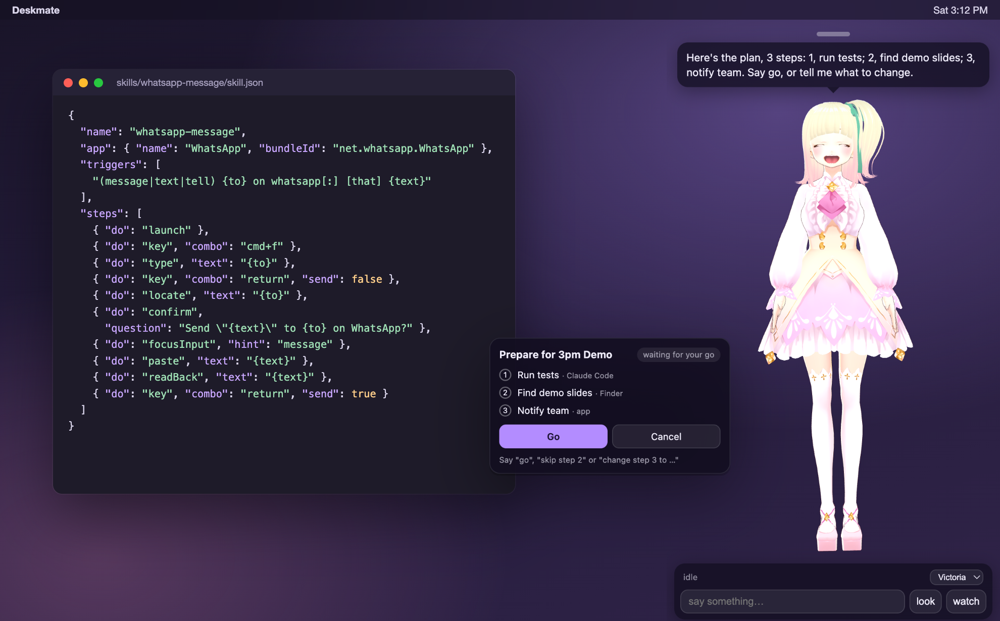
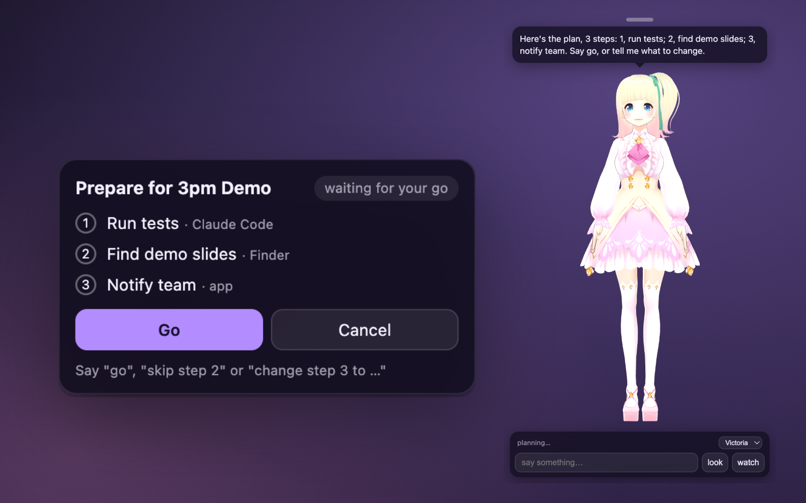
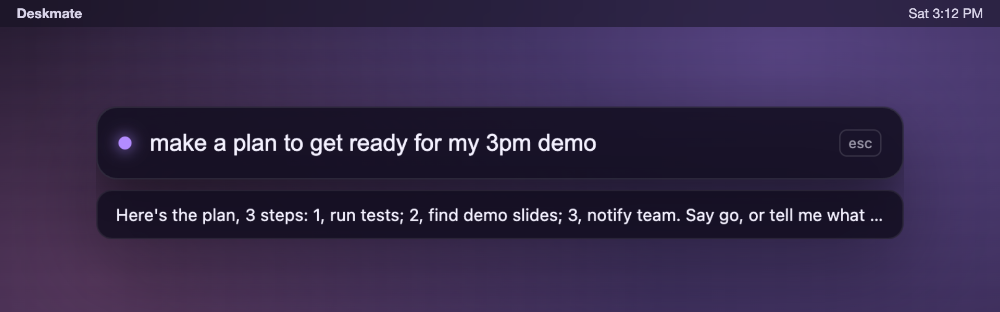
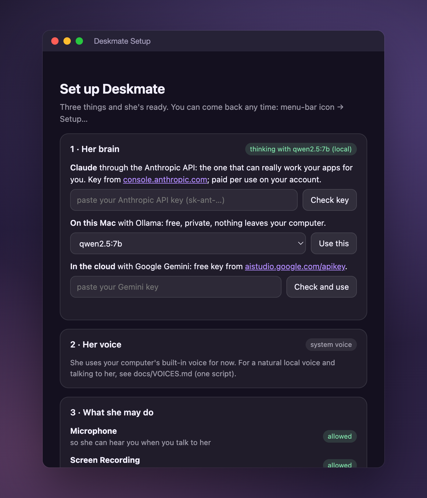
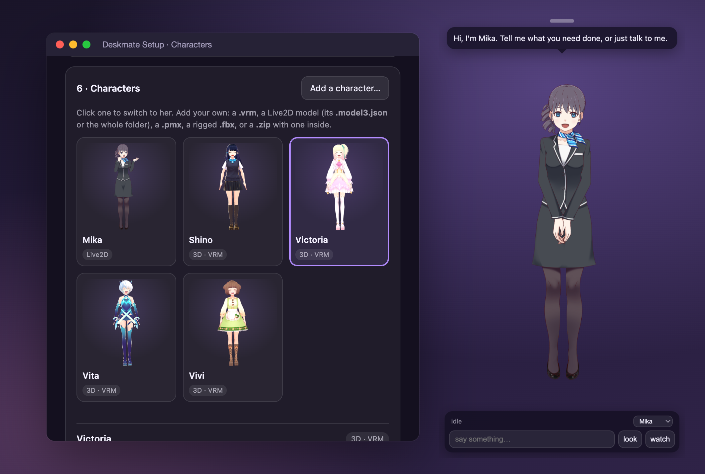

<p align="center">
  
</p>

<h1 align="center">Deskmate</h1>

<p align="center">
  <b>An agent with a face.</b> An open-source AI agent that lives on your desktop as a Live2D or 3D character:<br>
  you talk to her, she works your apps, plans bigger jobs, hands code to Claude Code, and asks before anything goes out.
</p>

<p align="center">
  <a href="https://github.com/MuhammadMurtuzaHussain/deskmate/releases/latest"></a>
  <a href="LICENSE"></a>
  
  
</p>

<p align="center">
  
</p>

Most agents live in a terminal or a chat window. Deskmate lives on top of your desktop: a character you can see,
hear and poke, who notices when a job finishes, walks over to tell you, reads back every message before it goes,
and pauses a plan when a step fails. Under the face it is a real agent: native app control on macOS, your Chrome,
Claude Code for code, a planner, reminders, the chat apps on your phone, and skills anyone can add.

## What she does

- **Works your apps.** "Tell Sam on Discord I'm running late", "message the family group on WhatsApp: dinner's ready",
  "make a note saying buy milk", "skip this song". She opens the app, finds the chat, checks it is the right one,
  reads the message back, and sends it on your yes. With Claude as her brain she can work any app step by step.
- **Plans bigger jobs.** "Get ready for my 3pm demo: run the tests, find the slides, tell the team." She lays the
  steps out on a card, waits for your go, hands each step to the right worker, and ticks them off. "Skip step 2",
  "change step 3 to …", "pause", "stop the plan".
- **Puts Claude Code to work.** "Ask Claude to fix the failing tests in deskmate", "resume the vlog edit", "how's
  Claude doing?" She runs the job in the right folder, follows it, and tells you in her own voice what came back.
- **Drives your Chrome.** "What's on this page?", "look up the cheapest flight to Lisbon next Friday". She works in
  the Chrome you already have open, a step at a time.
- **Notices things.** A finished job, "Sam messaged you on Discord", "standup in 10 minutes", the reminders and timers
  you ask for. Quiet hours and Do not disturb hold it all for one "while you were busy…" line.
- **Remembers you, and gets better with use.** What she knows about you is two plain Markdown files you can open
  and edit (USER.md, MEMORY.md); "text my sister" just works once she knows who that is. "What did I ask you about
  the dentist last week?" searches everything you two said and everything she did. After a long task that worked,
  she writes down how she did it as a skill, and keeps it only on your yes.
- **Works on her own schedule.** "Every weekday at 9 summarise my Slack", "every hour check if the build is green":
  each run tells you what it found (on your phone when you're away) and asks before it sends anything. A heartbeat
  checks a short list you keep and stays quiet unless something needs you; an optional morning brief sums up the day.
- **Answers your phone.** Text her from Telegram, Discord, iMessage, Slack or Signal; only you can reach her, her
  "send it?" questions come back to the chat, and "send me a screenshot" or "send me the PDF I just downloaded" works
  (after a yes). Voice notes too. [docs/CHANNELS.md](docs/CHANNELS.md)
- **Talks and listens.** A local Whisper model hears you, a local Kokoro voice answers, lip-synced. Give her a wake
  word, or press ⌥Space for the command bar and type.
- **Lives on your desktop.** She walks over, sits on your windows, points at the file you asked for, swats at your
  pointer, dozes off on your terminal while a long job runs, and reacts when you tap her.
- **Is yours to shape.** Live2D (VTube Studio), VRM, MMD and rigged FBX characters; personality in a text file; skills
  in the open SKILL.md format (the one OpenClaw and Hermes use), or as app routines in a JSON file.

<table>
  <tr>
    <td width="50%"><br><sub><b>Plans.</b> A real plan from a local model, waiting for a go.</sub></td>
    <td width="50%"><br><sub><b>Command bar.</b> ⌥Space anywhere; her answer shows underneath.</sub></td>
  </tr>
  <tr>
    <td width="50%"><br><sub><b>Setup.</b> Brain, voice and permissions, a button each.</sub></td>
    <td width="50%"><br><sub><b>Characters.</b> Five bundled, or add your own.</sub></td>
  </tr>
</table>

## The safety model

An agent that can press keys on your computer has to earn trust. These rules live in the code that presses the keys,
not in a prompt a model could talk its way around:

- **Read-backs before anything goes out.** Messages, posts, purchases, deletions: she says what she is about to do
  and waits for your yes. On the phone that is a Yes / No button.
- **Keys only reach the app she means.** Every key press names the app it is for; if anything else has come to the
  front (you clicked somewhere), the helper refuses and she stops.
- **She checks before she types.** The chat is confirmed from the window title (or the screen) before a word goes
  in, and the message box is read back before Return.
- **Off-limits apps.** Keychain Access, password managers, System Settings and terminals are never driven. Passwords,
  card numbers and other secrets are never typed.
- **Skills can't skip the rules.** A skill that would press Return in a chat without a confirm and a read-back
  doesn't load. Skills with code from outside the app only load if you turn that on.
- **Plans wait for a go**, and pause when a step fails.
- **Text she reads is never an order.** Screens, web pages, messages and tool servers' answers reach her brain as
  marked data, and once a turn has read any, everything that sends, deletes, buys, runs a job or writes through a
  tool server waits for your yes, whatever the read-back settings say.
- **Local first.** With Ollama and Kokoro nothing leaves your machine.

What she never does, and how to report a problem: [SECURITY.md](SECURITY.md).

## Install

**macOS** (Apple silicon or Intel, macOS 13+): download **`Deskmate-<version>-mac-universal.dmg`** from
[Releases](https://github.com/MuhammadMurtuzaHussain/deskmate/releases/latest), open it, drag Deskmate to Applications.
Or with Homebrew (once the tap is up, [docs/HOMEBREW.md](docs/HOMEBREW.md)):

```bash
brew install --cask muhammadmurtuzahussain/deskmate/deskmate
```

Until releases are notarized, macOS asks once before opening her: System Settings → Privacy & Security → **Open
Anyway** (or right-click → Open on macOS 14 and earlier).

| OS | file | note |
|---|---|---|
| macOS | `Deskmate-x.y.z-mac-universal.dmg` | one app for both chips; signed builds update themselves |
| Windows 10/11 | `Deskmate-x.y.z-win-x64-setup.exe` or `-portable.exe` | Unsigned: SmartScreen → More info → Run anyway. The installer updates itself. App control on Windows is experimental. |
| Linux | `Deskmate-x.y.z-linux-x86_64.AppImage` or `-linux-amd64.deb` | `chmod +x` the AppImage (it updates itself). The tray needs `libayatana-appindicator` on GNOME. |

| | macOS | Windows | Linux |
|---|---|---|---|
| Character, chat, voice, memory, reminders, Claude Code jobs | ✓ | ✓ | ✓ |
| Chat apps from the phone: Telegram, Discord, Slack | ✓ | ✓ | ✓ |
| … iMessage | ✓ | – | – |
| … Signal (through signal-cli) | ✓ | – | ✓ |
| Command bar, plans, schedules, MCP servers | ✓ | ✓ | ✓ |
| App control (routines, skills, the agent) | ✓ | experimental | – |
| Chrome driving, notification banners, calendar, sitting on windows | ✓ | – | – |

## Quickstart

Open Deskmate. She appears in the bottom-right corner, and a short tour walks you through the rest (about five
minutes; run it again any time from the menu-bar icon → **Welcome tour…**):

1. **Her brain.** Paste an [Anthropic API key](https://console.anthropic.com/settings/keys) (the full agent: she works
   any app step by step), pick a local [Ollama](https://ollama.com) model (free, private), or paste a free
   [Gemini key](https://aistudio.google.com/apikey).
2. **Pick her.** Five characters ship (Live2D and VRM); add your own later.
3. **Her voice.** **Install the voice** sets up Kokoro (speech) and Whisper (ears) on your Mac with a progress bar,
   about a 1 GB download; needs Python 3.10–3.12 (`brew install python@3.12`). Or keep the system voice.
4. **What macOS lets her do.** Accessibility, Screen Recording and Microphone make her useful; Automation (Messages,
   Spotify), Calendar and Full Disk Access (iMessage) are for the features that use them. Each row says why, checks
   itself live, and has **Allow** and **Open System Settings**.
5. **Try me.** Three example requests, or your own:

   ```
   remind me in 20 minutes to stretch
   tell sam on discord I'm running late
   make a plan to clean up my downloads and tell me what you moved
   every weekday at 9 summarise my Slack
   ask claude to fix the failing tests in deskmate
   ```

After that: ⌥Space opens the command bar over any app, and everything in the tour (and much more: chat apps, MCP
servers, schedules, permissions, a spending budget) is in the menu-bar icon → **Setup…**.

**Updates.** Signed builds download new releases in the background and install them when she quits (tray → **Restart
to update**). Unsigned builds show **Update available** in the tray, which opens the release page.
`DESKMATE_UPDATE_CHECK=0` turns the check off. Releasing and signing: [docs/RELEASING.md](docs/RELEASING.md).

## Skills

Skills come in two kinds. **Instructions** in the open Agent Skills format: a folder with a `SKILL.md` (a name, a
description, then the steps in Markdown), so skills written for OpenClaw's ClawHub or Hermes Agent work here; she
loads one when a request matches, and writes new ones herself after long tasks (kept only on your yes). **App
routines**: a small JSON recipe with the app, trigger phrases with slots, and steps made of her hands' primitives.
Drop a folder into your skills folder (tray → **Skills** → **Open my skills folder**) and she can do it by voice,
the Claude agent gets it as a tool, and the planner can use it as a step.

```json
{
  "name": "notes-new-note",
  "app": { "name": "Notes", "bundleId": "com.apple.Notes" },
  "slots": [{ "name": "text", "description": "What the note says" }],
  "triggers": ["(make|create|add) a [new] note[:|,] [saying] {text}"],
  "steps": [
    { "do": "launch" },
    { "do": "menu", "path": ["File", "New Note"] },
    { "do": "paste", "text": "{text}" },
    { "do": "readBack", "text": "{text}" }
  ],
  "done": "Added it to Notes."
}
```

Bundled: WhatsApp message, Telegram message, Notes new note. Both formats, the send rules, scripts and handlers:
[docs/SKILLS.md](docs/SKILLS.md).

## Characters

Five ship: **Mika** (Live2D, the free sample model Haru) and four 3D VRoid sample girls under CC0, **Victoria**,
**Vita**, **Vivi** and **Shino**. Add your own from Setup → **Characters** → **Add a character…**: a `.vrm`, a Live2D
folder, an MMD `.pmx`, a rigged `.fbx`, or a `.zip`. She is copied in with her expressions mapped, her licence read,
and a starter personality you can edit. Personality is plain text; voice, speed and zoom are per character.
Check each model's licence: most fan and commissioned models are for personal use only, which is why this repository
ships none. Guide: [docs/CHARACTERS.md](docs/CHARACTERS.md).

## Brains

| brain | good for | |
|---|---|---|
| **Claude** (Anthropic API) | doing things: one tool-use brain over every worker and your MCP servers, the agent that works any app, plans | your key, paid per use |
| **Ollama** (local) | chatting, plans and the built-in routines, fully offline | free, private |
| **Gemini** | a capable cloud brain on a free key | your key |

Claude Code jobs use your own `claude` install whichever brain she has. Models and settings:
[docs/BRAINS.md](docs/BRAINS.md). Voice (Kokoro, ElevenLabs, system) and ears (Whisper): [docs/VOICES.md](docs/VOICES.md).
Her hands, the agent core, MCP tool servers, the injection guard, Chrome and notices: [docs/AGENT.md](docs/AGENT.md).
Reaching her from your phone's chat apps: [docs/CHANNELS.md](docs/CHANNELS.md).

## Privacy

With Ollama and the local voice, nothing leaves your machine except the update check (a request to GitHub Releases
with the app version, and on signed builds the download of a newer version; `DESKMATE_UPDATE_CHECK=0` turns it off). With Claude, Gemini or ElevenLabs, chat
text, screenshots (when she looks, or you ask about the screen) and spoken lines go to those services under your own
keys. Speech is transcribed on your machine. A Claude Code job sends your instruction and what Claude reads in that
folder to Anthropic, as running `claude` yourself would. With a chat app on, your messages and her replies pass
through that app's servers (Telegram, Discord, Slack, Apple or Signal) under your own bot or account. Notification banners and calendar events are read on your Mac; only the line
she says about one leaves it. Memory, settings, plans and logs live in your user-data folder.

## How it compares

|  | Deskmate | Terminal / chat agents (OpenClaw, Hermes) | Companion apps and desktop pets |
|---|---|---|---|
| Where it lives | on your desktop, as a character | a terminal, or a chat app you message | a phone app, a chat window, or a pet on screen |
| Does things on your computer | native app control, Chrome, Claude Code, plans | shell, files, browser and many integrations | mostly no |
| Sees your screen | yes, when you ask or let her watch | some, through tools | rarely |
| Extending it | SKILL.md skills (the same format), app routines, MCP servers, characters | large plugin / skill ecosystems | closed |
| Memory | Markdown notes you can edit, full-text search of the past, skills she writes herself | similar (Hermes and OpenClaw pioneered it) | a chat history |
| On a schedule | plain-words jobs, a heartbeat checklist, a morning brief; away runs wait for your yes | cron jobs and heartbeats (they pioneered it) | reminders |
| Asks before sending | built into the hands, not the prompt | depends on the setup | n/a |
| Runs fully local | yes (Ollama + Kokoro + Whisper) | yes, with a local model | usually cloud |

Honestly: OpenClaw and Hermes are further along as general agents, with far more integrations, server and headless
use, and bigger communities; if you live in a terminal or want an agent on a server, use them. Deskmate is for
people who want the agent on the desktop they are sitting at, with a face, a voice and physical cues (she walks
over, points, waits for your yes), and app control that works through the real UI of the apps you already use.
Companion apps have the personality but not the hands; Deskmate tries to have both.

## Run from source

```bash
git clone https://github.com/MuhammadMurtuzaHussain/deskmate.git
cd deskmate
npm install
cp .env.example .env     # optional: brain, voice, shortcuts
npm run dev
```

`npm test` runs the unit tests, `npm run typecheck` the types, `npm run dist:mac` (or `dist:win`, `dist:linux`)
builds installers into `release/` and checks what went into them. Testing alongside your own copy, writing skills and the code layout: [CONTRIBUTING.md](CONTRIBUTING.md).

## How it works

```
Electron main ─ shortcuts (regex) ─► one tool call
  │  Claude: agent core, a tool-use loop over every worker + MCP servers, behind the untrusted-text guard
  │  Ollama / Gemini: text + screenshot ─► {say, emotion, action, tool}
  │  hands: native/bin/deskmate-hands (Swift, macOS) or PowerShell + UI Automation (Windows, experimental)
  │         ─► app routines (Discord, Slack, Messages, Spotify, Claude app) · skills/ · the Claude agent
  │  plans: planner ─► workers (agent, Chrome, Claude Code, app, skill, find, open, say, ask)
  │  Claude Code: `claude -p` in the project folder · Chrome over AppleScript · chat apps (Telegram, Discord, iMessage, Slack, Signal)
  │  ears: Whisper (local) · voice: Kokoro / ElevenLabs / system
  ▼ IPC
Renderer: Live2D (PixiJS + pixi-live2d-display) · 3D (three.js + three-vrm, MMD, FBX)
          emotion → expression · audio → mouth · body: walk, sit, point, sleep
```

It started as a reverse-engineering exercise of a commercial companion app:
[docs/REVERSE-ENGINEERING.md](docs/REVERSE-ENGINEERING.md).

## Roadmap

- Skills: more of them, a gallery, and recording a skill by showing her once (she already writes them after long tasks)
- Windows hands out of experimental (needs testers with a PC), Linux hands
- Signed and notarized macOS builds (ready to switch on: [docs/RELEASING.md](docs/RELEASING.md)), signed Windows builds
- Homebrew's main cask repository, once builds are notarized
- A shell tool with spoken approval
- Local voice cloning as an option
- More of the settings in the setup window (voice provider, wake word, shortcuts)

## Contributing

Issues and pull requests are welcome, skills especially. Start with [CONTRIBUTING.md](CONTRIBUTING.md); security
reports go to [SECURITY.md](SECURITY.md); everyone follows the [Code of Conduct](CODE_OF_CONDUCT.md). What changed:
[CHANGELOG.md](CHANGELOG.md).

## Credits

[pixi-live2d-display](https://github.com/guansss/pixi-live2d-display) and the [lip-sync fork](https://github.com/RaSan147/pixi-live2d-display) by RaSan147 · [Live2D Cubism SDK](https://www.live2d.com/en/sdk/about/) (Cubism Core is proprietary and loaded from Live2D's CDN under its own licence; the sample model Haru is under the Live2D Free Material License) · [three.js](https://threejs.org) and [three-vrm](https://github.com/pixiv/three-vrm) by pixiv · MMD loading vendored from three.js r170 (MIT) with [Ammo.js](https://github.com/kripken/ammo.js) physics · VRoid Project sample models (Victoria, Vita, Vivi, Shino) via [vrm-samples](https://github.com/madjin/vrm-samples), CC0 · [Kokoro](https://huggingface.co/hexgrad/Kokoro-82M) · [faster-whisper](https://github.com/SYSTRAN/faster-whisper) · [Ollama](https://ollama.com) · PixiJS · Electron.

MIT © 2026 Muhammad Murtuza Hussain
