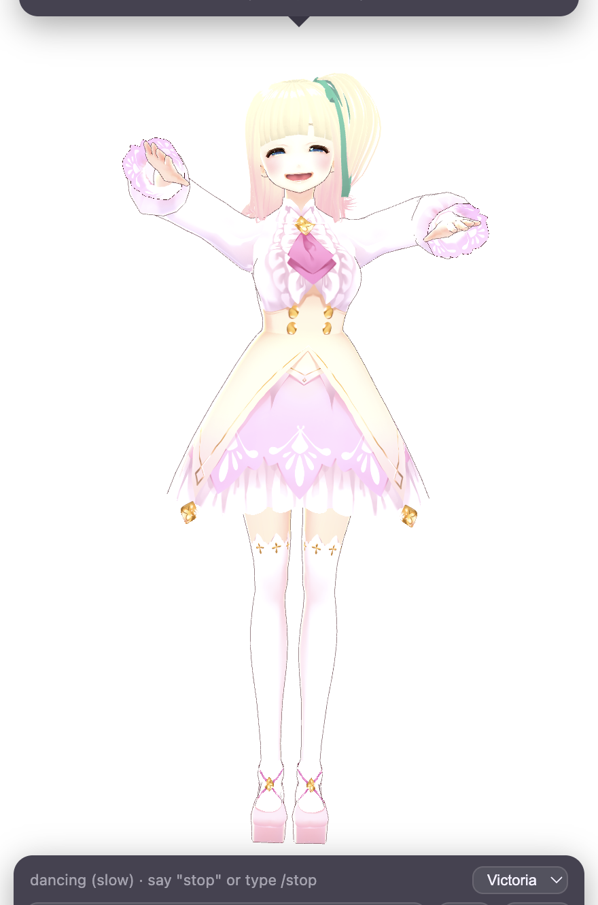

<p align="center">
  
</p>

<h1 align="center">Deskmate</h1>

<p align="center">
  <b>A Live2D or 3D AI companion that lives on your desktop.</b><br>
  She watches what you're doing, talks back with a real voice and real expressions, dances when you ask, remembers you, and reacts when you poke her.<br>
  Runs <b>100 % local</b> with Ollama + Kokoro, or on Gemini. macOS, Windows, Linux.
</p>

<p align="center">
  <a href="https://github.com/MuhammadMurtuzaHussain/deskmate/releases/latest"></a>
  <a href="LICENSE"></a>
  
  
</p>

<p align="center">
  
  &nbsp;
  
  &nbsp;
  
</p>
<p align="center"><sub>Left: the bundled Live2D character. Middle: the bundled 3D character mid-dance. Right: your own VTube Studio model dropped in (see <a href="docs/CHARACTERS.md">Characters</a>).</sub></p>

---

## What she does

- **Lives on top of everything.** A transparent, always-on-top Live2D character, click-through except on her, with a menu-bar / tray icon to show, hide, and quit. Start at login from the tray.
- **Sees your screen.** Press *look* and she reacts to what you're doing; turn on *watch* and she glances over every minute and speaks up when something catches her eye. Point her at a project folder and she notices what you edit.
- **Actually helps.** Ask "what's this error" or "what should I do next" and she reads the screen and answers properly, then goes back to being herself.
- **Talks, and listens.** Lip-synced speech through a local Kokoro voice, ElevenLabs, or your system voice; expressions and body language follow the emotion of every line. Press ⌘⇧Space and just talk: a local Whisper model hears you, she answers out loud. Or give her a wake word and only say her name; talk over her and she stops and listens. Speech to speech, nothing sent anywhere.
- **Puts Claude to work.** "Ask Claude to fix the failing tests in deskmate", "resume the vlog edit", "how is Claude doing": she hands the job to [Claude Code](https://docs.anthropic.com/en/docs/claude-code) in the right project folder, follows it, and tells you in her own voice what came back. Spoken jobs are read back and wait for your yes. [docs/AGENT.md](docs/AGENT.md).
- **Command bar.** Press ⌥Space (Alt+Space) anywhere, type what you want ("tell sam on discord I'm late", "open github", "ask claude to fix the build"), Enter. Her answer shows under the bar; when she asks "send it?", type yes right there. Works with her hidden.
- **Stays out of the way.** Her chat panel tucks away and comes back when you move the pointer over her or the bottom of her window; while it is away, news ("Discord · finding sam") shows as a short status line.
- **Works your apps (macOS).** "Tell sam on Discord I'm running late", "text Note Pad that I'm on my way, and send a photo of yourself", "message #general in Slack: standup moved", "skip this song", "open Claude and ask it to draft a cover letter". She opens the app even if it's closed, jumps to the chat, checks the window shows the right one, reads the message back, and sends it on your yes. [docs/AGENT.md](docs/AGENT.md#apps-discord-slack-and-the-claude-app-macos).
- **Drives your Chrome (macOS).** "What’s on this page", "search for Dublin weather", "next tab", "click sign in", or a whole goal: "look up the cheapest flight to Lisbon next Friday". She works in the Chrome you already have open, logged in as you, reading the page text and clicking through with her own brain, a step at a time. Anything that pays, sends, posts or deletes is read back to you first; passwords are never typed.
- **Remembers.** A tiered memory per character: what matters sticks, small talk fades. `/forget` wipes it.
- **Lives on your desktop.** "Come here", "sit on this window" (she sits on its top edge, legs dangling, and rides along when you move it), "go to sleep", "walk around". "Where's my resume?" and she finds it, opens Finder on it, walks over and points at it with a ring around the spot. Carry her by the head and she dangles. Left alone for ten minutes she dozes off. Full body in 3D (VRM); with a Live2D model she leans, bobs, looks, and uses the model's own poses.
- **Reacts to touch.** Tap her head, tummy or elsewhere for different reactions; press and drag her anywhere on the screen and she comments.
- **Dances and changes outfits (3D characters).** No buttons: ask her ("dance for me", "something slower", "spin", "change your outfit") and she decides to; or type `/dance`, `/slow`, `/spin`, `/outfit`, `/stop`. Built-in choreographies (upbeat groove, slow and sensual, a twirl) with smooth blends, and real motion capture when you drop clips in: Mixamo `.fbx` dances retarget straight onto any VRM character, `.vrma` plays as is, `.vmd` for MMD. Hair and skirts move with the model's own physics.
- **Is yours to shape.** Personality is a plain-text file. Models are standard Live2D / VTube Studio folders, VRM avatars (VRoid Studio, VRoid Hub, Booth), MMD models (.pmx) or a plain .obj/.glb. Multiple characters, switchable from the panel or the tray, each with her own voice and memory.
- **Runs offline.** With Ollama (brain) and Kokoro (voice) nothing leaves your machine, not even the screenshots.

## Install

Grab the latest build from the [Releases page](https://github.com/MuhammadMurtuzaHussain/deskmate/releases/latest):

| OS | file | note |
|---|---|---|
| macOS (Apple Silicon / Intel) | `Deskmate-x.y.z-mac-arm64.dmg` / `-x64.dmg` | Unsigned: on first launch right-click → Open, or run `xattr -dr com.apple.quarantine /Applications/Deskmate.app`. Allow **Screen Recording** when asked so she can see your screen. |
| Windows 10/11 | `Deskmate-x.y.z-win-x64-setup.exe` (installer) or `-portable.exe` | Unsigned: SmartScreen → "More info" → "Run anyway". |
| Linux | `Deskmate-x.y.z-linux-x86_64.AppImage` or `-linux-amd64.deb` | `chmod +x` the AppImage. Tray icon needs `libayatana-appindicator` on GNOME. |

She starts in the bottom-right corner. The first time, a **setup window** walks you through her brain (a local Ollama model it finds on your Mac, or a Gemini key it checks for you), her voice, and the permissions she needs (microphone, screen, Accessibility), with a button for each. Come back to it any time from the menu-bar icon → **Setup…**. The sections below are the same steps by hand.

### Give her a brain (2 minutes)

**Claude (best at doing things):** paste an [Anthropic API key](https://console.anthropic.com/settings/keys) into the setup window and pick a model (Claude Opus 5.5 by default; Sonnet 5.5 and Haiku 5.5 are quicker and cheaper). Billed per use to your Anthropic account. With Claude she also gets a real agent for multi-step jobs on your Mac ("open Spotify and play my liked songs", "in Notes, start a shopping list with milk and eggs"): it works your apps step by step, checks each step, and asks before anything that sends, posts, deletes or pays. [docs/AGENT.md](docs/AGENT.md#claude-brain-and-the-agent-on-your-mac).

**Local, free, private (recommended):** install [Ollama](https://ollama.com), then

```bash
ollama pull qwen3-vl:4b-instruct
```

and in the settings folder (tray menu → *Open settings folder*) create a file named `.env`:

```
DESKMATE_BRAIN=ollama
OLLAMA_MODEL=qwen3-vl:4b-instruct
```

**Cloud:** get a free key at [aistudio.google.com/apikey](https://aistudio.google.com/apikey) and paste it into the setup window (or the field in her panel). Done.

Details, other models, and running both: [docs/BRAINS.md](docs/BRAINS.md).

### Give her a voice, and ears (optional)

Without setup she uses your system voice. For a natural one: [docs/VOICES.md](docs/VOICES.md) covers the local open-source Kokoro voice (one script) and ElevenLabs (an API key). The same script installs Whisper, so with the local voice on you can talk to her: ⌘⇧Space (Ctrl+Shift+Space), the **mic** button, or **Listen hands-free** in the tray.

### Give her hands (optional)

On a Mac she can message people on Discord and Slack and prompt the Claude app for you: switch on **Accessibility** for Deskmate when she asks (System Settings → Privacy & Security → Accessibility). Details: [docs/AGENT.md](docs/AGENT.md#apps-discord-slack-and-the-claude-app-macos).

On a Mac she can also drive the Chrome you have open: say yes when macOS asks, and switch on **View → Developer → Allow JavaScript from Apple Events** in Chrome once so she can read pages and click. Details and the safety rules: [docs/AGENT.md](docs/AGENT.md#browser-she-drives-your-chrome).

If [Claude Code](https://docs.anthropic.com/en/docs/claude-code) is installed and logged in on your machine, she can give it jobs: "ask Claude to …", "resume the vlog edit", "stop the task". Pick the folder she works in from the tray menu, or name it in the sentence. How it works, what Claude is allowed to do, and how to turn the read-back confirmation on or off: [docs/AGENT.md](docs/AGENT.md).

## Run from source

```bash
git clone https://github.com/MuhammadMurtuzaHussain/deskmate.git
cd deskmate
npm install
cp .env.example .env     # edit: brain, voice, watch folder
npm run dev
```

`npm run dist` builds installers for your current OS into `release/`.

## Make her yours

| what | where | how |
|---|---|---|
| Personality | `character/<id>/persona.md` | Plain English. Who she is, how she talks, what she reacts to, how far flirting goes. |
| Look | `character/<id>/character.json` | Live2D Cubism 3/4 (incl. VTube Studio models), VRM 0.x/1.0, MMD `.pmx`, or a static `.obj`/`.glb`. Map her expressions to nine emotions. |
| Moves | `character/<id>/character.json` | 3D only: `dance.bpm`, `animations` (Mixamo `.fbx` or `.vrma` for VRM, `.vmd` for MMD), `outfits` (other model files, parts to hide, materials to recolour). |
| Private tweaks | `character/<id>/local.json` | Gitignored overlay for your own clips, voice or model path, merged over `character.json`. |
| Voice | `character/<id>/character.json` → `voice` | Kokoro preset, ElevenLabs voice id, system voice. |
| Jiggle | `physics` in `character.json` | `sway` and `bounce` drive the model's own physics rig (hair, tail, chest). |
| New character | copy `character/mika/` | Put it next to `mika`, or in your user-data folder so updates don't touch it. Switch from the panel dropdown or the tray. |

Full guide: [docs/CHARACTERS.md](docs/CHARACTERS.md). Five characters ship, each with her own personality: Mika (Live2D, the free sample model Haru) and four 3D girls from VRoid's CC0 sample set, Victoria, Vita, Vivi and Shino, fetched on first use so the download stays small. Want a specific character from a game or an app? Bring the model yourself: VRoid Hub and Booth are full of VRM avatars, including fan versions of popular AI companions and VTubers; MMD models (.pmx) load as they are. Check each model's licence; most fan and commissioned models are for personal use only, which is why this repository ships none.

## Settings reference

All settings are environment variables, read from `.env` / `.env.local` in the user-data folder (installed app) or the project root (source). See [`.env.example`](.env.example) for the full list: brain and model, voice provider and preset, ears (Whisper size, shortcut, wake word, barge-in), hands (Claude Code folder, permissions, confirmation), watch folder and interval, default character.

| folder | macOS | Windows | Linux |
|---|---|---|---|
| user data (settings, memory, your characters) | `~/Library/Application Support/deskmate` | `%APPDATA%\deskmate` | `~/.config/deskmate` |

## How it works

```
Electron main ──── Ollama / Gemini (text + screenshot) ──► {say, emotion, speak, remember, action, tool}
   │  desktopCapturer every N s, chokidar on your project folder
   │  mic ──► Whisper (local) ──► text · Kokoro / ElevenLabs / say ──► audio
   │  tool: claude ──► `claude -p` in the project folder (stream-json) ──► she reports back
   │  tool: browse / page ──► Chrome over AppleScript (tabs, page text, click, type) ──► look · decide · act loop
   │  tool: app ──► native/bin/deskmate-hands (Swift: open -b, key events, accessibility titles) ──► Discord · Slack · Claude routines
   ▼ IPC
Renderer: Live2D: PixiJS 7 + pixi-live2d-display (lip-sync fork) + Live2D Cubism Core
          3D: three.js + three-vrm (VRM) · vendored MMDLoader + Ammo physics (MMD) · OBJ/GLTF (static)
          emotion → expression / morphs · audio volume → mouth · sway, bounce, choreography → bones + physics
```

The LLM returns a line plus an emotion tag; the tag picks a Live2D expression, the line goes to TTS, and the audio drives the mouth. Memory is a small JSON store with importance-weighted forgetting. The whole thing started as a reverse-engineering exercise of a commercial companion app; the write-up is in [docs/REVERSE-ENGINEERING.md](docs/REVERSE-ENGINEERING.md).

## Privacy

Local mode sends nothing anywhere. With Gemini or ElevenLabs configured, chat text, screenshots (on looks and screen-related questions) and spoken lines go to those services under your own keys. What you say is transcribed on your machine. A Claude job sends your instruction and whatever Claude Code reads in that folder to Anthropic, exactly as running `claude` there yourself would. Memory and settings live in your user-data folder and nowhere else.

## Roadmap

- More for her hands: reminders, calendar, a shell tool with spoken approval
- Voice cloning via Chatterbox as a local option
- More settings in the setup window (voice provider, wake word, shortcuts)
- Signed builds

## Credits

[pixi-live2d-display](https://github.com/guansss/pixi-live2d-display) and the [lip-sync fork](https://github.com/RaSan147/pixi-live2d-display) by RaSan147 · [Live2D Cubism SDK](https://www.live2d.com/en/sdk/about/) (Cubism Core is proprietary and loaded from Live2D's CDN under its own license; the sample model Haru is under the Live2D Free Material License) · [three.js](https://threejs.org) and [three-vrm](https://github.com/pixiv/three-vrm) by pixiv · MMD loading vendored from three.js r170 (MIT) with [Ammo.js](https://github.com/kripken/ammo.js) physics · [Victoria Rubin](https://github.com/madjin/vrm-samples) sample model by VRoid Project, CC0 · [Kokoro](https://huggingface.co/hexgrad/Kokoro-82M) · [faster-whisper](https://github.com/SYSTRAN/faster-whisper) · [Ollama](https://ollama.com) · PixiJS · Electron.

MIT © 2026 Muhammad Murtuza Hussain
